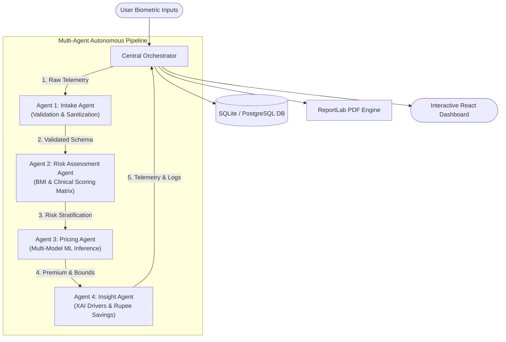

# PremiumPulse Architecture & Technical Specifications

**The Big Hack 2026 Entry**  
**Project:** PremiumPulse – AI-Agent Powered Health Insurance Premium Prediction  
**System Version:** 1.0.0 Production Architecture

---

## 1. System Overview

PremiumPulse is a fintech-healthcare insurtech platform that computes personalized, risk-adjusted health insurance premium estimations. By combining classical actuarial science, multi-model machine learning, and a multi-agent AI architecture, the platform delivers transparent, explainable, and dynamic policy pricing.

---

## 2. Multi-Agent AI Architecture

The system coordinates four specialized autonomous agents supervised by a Central Orchestrator:

### 2.1 Agent Roles and Contracts

1. **Intake Agent (`IntakeAgent`)**
   - **Contract:** Ingests raw user inputs; executes physiological bounds checking (Age 18–100, Height 80–250cm, Weight 30–250kg).
   - **Telemetry:** Verifies consistency (e.g. high declared activity with low recorded daily steps).
   - **Output:** Returns sanitized, normalized feature dictionary.

2. **Risk Assessment Agent (`RiskAssessmentAgent`)**
   - **Contract:** Calculates physiological Body Mass Index:
     $$\text{BMI} = \frac{\text{weight}_{\text{kg}}}{(\text{height}_{\text{m}})^2}$$
   - **Scoring Matrix:** Computes a composite hazard index ($0 - 100$) combining tobacco use, BMI threshold multipliers, age brackets, daily step mobility, resting heart rate, and pre-existing chronic conditions.
   - **Output:** Stratifies user into `Low Risk` ($<35$), `Moderate Risk` ($36-65$), or `High Risk` ($66-100$).

3. **Pricing Agent (`PricingAgent`)**
   - **Contract:** Loads pre-trained serialized models (`Linear Regression`, `Random Forest`, `XGBoost`).
   - **Inference:** Executes parallel inference across all three models.
   - **Selection:** Dynamically benchmarks model accuracy ($R^2$ score) on the test split and selects the top-performing estimator.
   - **Actuarial Calibration:** Calibrates medical claim risk baseline to annual policy premiums in INR ($\text{₹}$):
     $$\text{Premium}_{\text{INR}} = \text{Charge}_{\text{USD}} \times 83.50 \times 0.055 \times \text{Coverage Multiplier}$$
   - **Output:** Returns point estimate, multi-model comparison table, and uncertainty band ($[\text{Min}, \text{Max}]$).

4. **Insight Agent (`InsightAgent`)**
   - **Contract:** Decomposes feature contributions (SHAP-inspired weights).
   - **Explainability:** Identifies top negative and positive cost drivers (e.g., active smoker loading vs. mobility discounts).
   - **Quantified Savings:** Computes exact potential annual rupee savings achievable through targeted lifestyle habits (quitting smoking, reaching $\text{BMI} < 25$, logging $10,000$ steps).
   - **Dual Engine:** Integrates external LLM (Google Gemini API) with an intelligent actuarial rule-based fallback when offline or without an API key.

5. **Central Orchestrator (`CentralOrchestrator`)**
   - **Contract:** Coordinates the sequential execution chain, measures sub-millisecond execution latencies, records persistent audit logs, and compiles the final underwriting response.

---

## 3. Machine Learning Pipeline & Benchmark

### 3.1 Training Dataset
- **Dataset:** Kaggle Medical Cost Personal Dataset ($1,338$ records).
- **Features:** `age`, `sex`, `bmi`, `children`, `smoker`, `region`, `charges`.
- **Engineered Features:** 
  - `obese` ($\text{BMI} \ge 30$)
  - `smoker_obese_interaction` ($\text{is\_smoker} \times \text{obese}$)
  - `smoker_bmi_interaction` ($\text{is\_smoker} \times \text{bmi}$)
  - `age_squared` ($(\text{age}/10)^2$)
  - One-hot region indicators.

### 3.2 Evaluation Results (Test Split $20\%$, $n = 268$)

| Model Architecture | Algorithm Class | $R^2$ Score | MAE (USD) | MAE (INR Calibrated) |
| :--- | :--- | :--- | :--- | :--- |
| **Linear Regression** | Ordinary Least Squares with Interactions | **$0.8830$** | **$\$2,315.52$** | **$₹10,634.04$** |
| **XGBoost Regressor** | Extreme Gradient Boosted Trees ($150$ est) | **$0.8769$** | **$\$2,421.53$** | **$₹11,120.90$** |
| **Random Forest** | Nonlinear Bagging Ensemble ($150$ trees) | **$0.8702$** | **$\$2,549.09$** | **$₹11,706.68$** |

---

## 4. Database Schema (SQLite / PostgreSQL Ready)

1. **`users`**: User identity, hashed credentials (PBKDF2-SHA256 with cryptographic salt), profile metadata.
2. **`user_health_profiles`**: 1:1 relationship containing latest verified biometrics, chronic conditions, and preferences.
3. **`prediction_history`**: Audit trail of every prediction, model parameters, multi-model outputs, and insights.
4. **`agent_execution_logs`**: Microsecond execution timestamps, status flags, and step summaries for every agent run.
5. **`wearable_health_data`**: Time-series health records from manual inputs or simulated smartwatch telemetry.

---

## 5. Wearable Health Architecture

- **Connected Sources:** Simulated Apple HealthKit, Fitbit Web API, and Garmin Connect telemetry.
- **Dynamic Recalculation:** When new biometric telemetry (e.g. daily steps $\ge 10,000$ or weight loss) is ingested, the system automatically triggers an underwriting recalculation, providing instant feedback on premium discounts.

